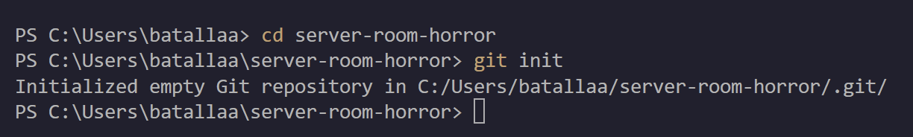
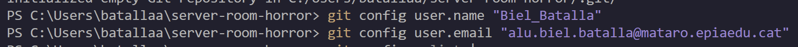
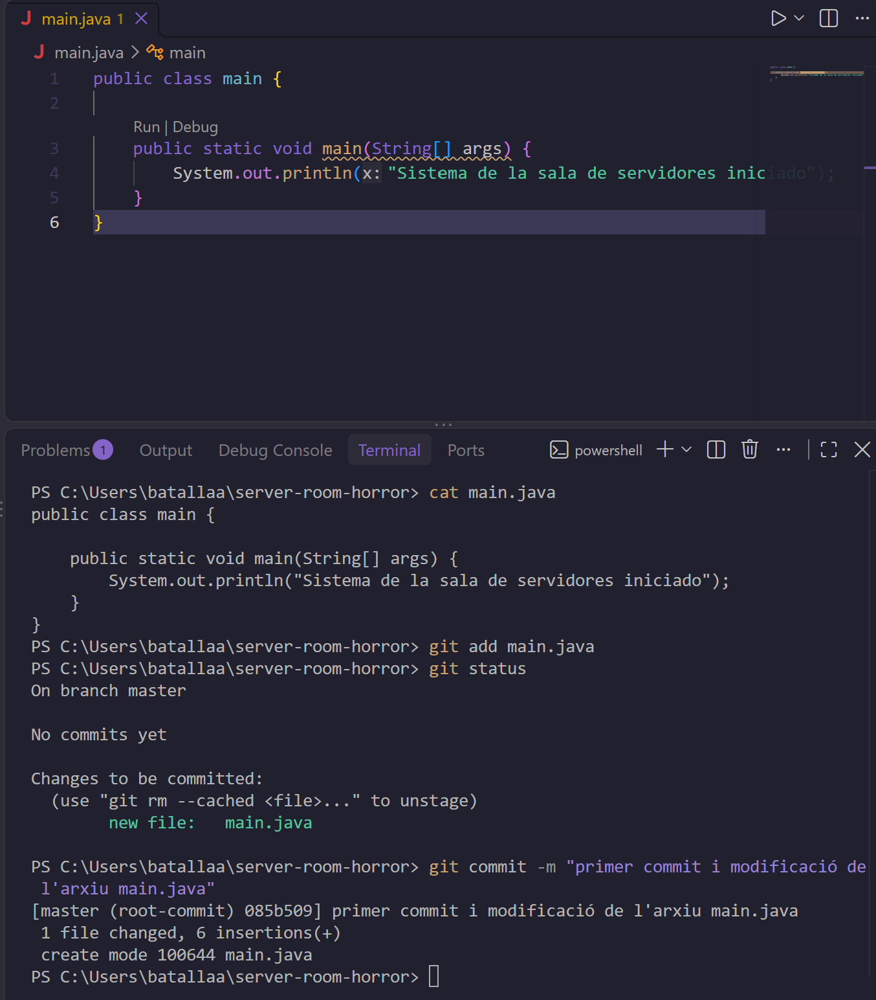
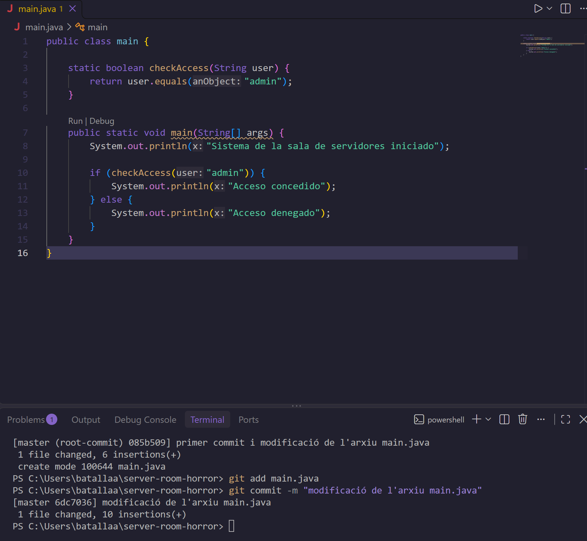
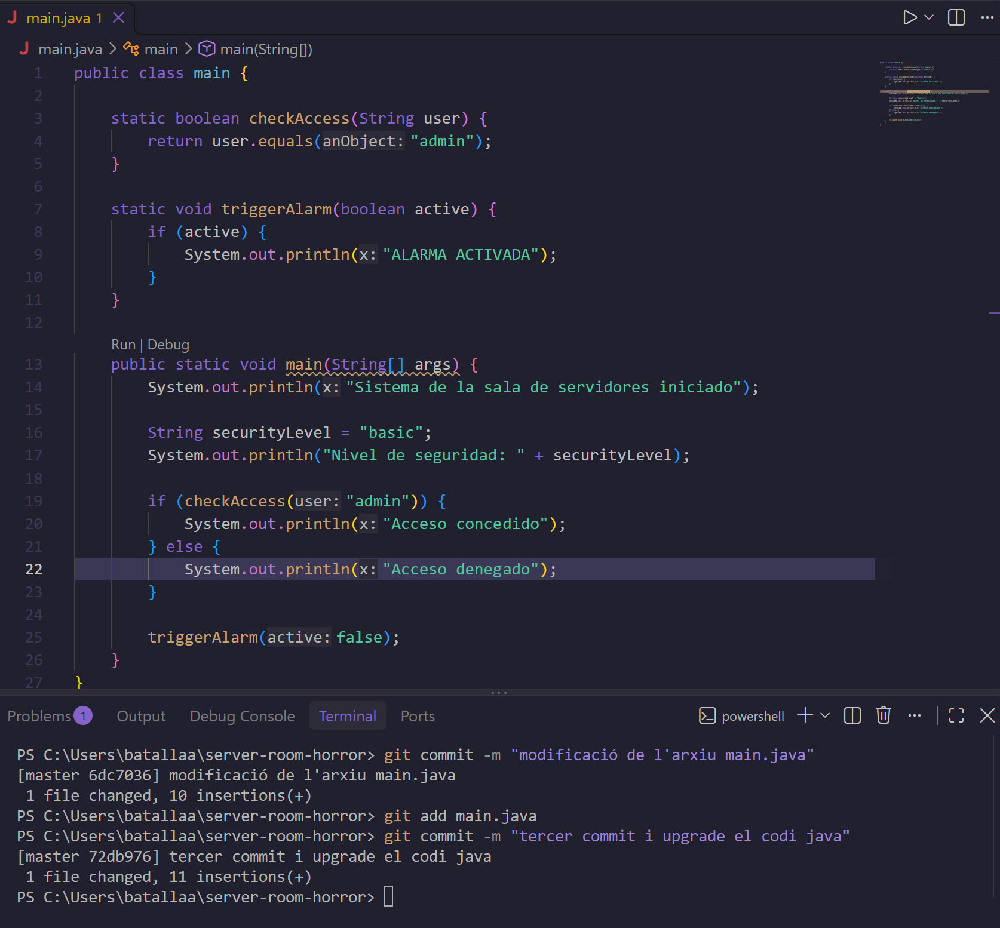
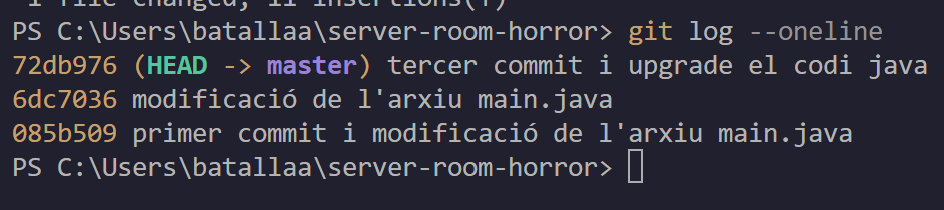

# Bloc 1: Invocació del Repositori i Línia Base

[← Tornar al README](README.md) | [Bloc 2 →](bloc2.md)

En aquest bloc es construeix el repositori local des de zero i s'estableix una línia temporal estable de tres commits sobre l'aplicació Java de la sala de servidors.

---

## Acció 3.1: Creació del directori i inicialització de Git

**Explicació tècnica:** es crea el directori buit `server-room-horror`, s'hi accedeix i s'executa `git init`, que genera la carpeta oculta `.git` amb l'estructura interna del repositori (objectes, referències i configuració). A partir d'aquest moment el directori és un repositori local.

```bash
mkdir server-room-horror
```


```bash
cd server-room-horror
git init
```



---

## Acció 3.2: Configuració de la identitat

**Explicació tècnica:** Git signa cada commit amb un nom i un correu d'autor. Es configuren amb `git config` a nivell de repositori, de manera que tots els commits quedin identificats amb les dades professionals. Amb `git config --list` es comprova que els valors s'han desat.

```bash
git config user.name "Biel_Batalla"
git config user.email "alu.biel.batalla@mataro.epiaedu.cat"
git config --list
```



---

## Acció 3.3: Primer commit (fitxer principal de l'aplicació)

**Explicació tècnica:** es crea `main.java` amb una estructura mínima: una classe amb el mètode `main` que mostra per pantalla que el sistema s'ha iniciat. Amb `git add` el fitxer passa a l'àrea de preparació (*staging*), `git status` ho verifica (apareix com a *new file* en verd) i `git commit` el desa a l'historial. Aquest és el commit arrel (*root-commit*).

```bash
cat main.java
git add main.java
git status
git commit -m "primer commit i modificació de l'arxiu main.java"
```



---

## Acció 3.4: Dos commits successius del sistema de seguretat

**Explicació tècnica:** s'apliquen dues modificacions al fitxer i cadascuna es registra en un commit independent, per mantenir la traçabilitat de cada canvi.

### Commit 2: control d'accés

S'afegeix el mètode `checkAccess`, que només concedeix l'accés a l'usuari `admin`, i es crida des de `main` per mostrar "Acceso concedido" o "Acceso denegado".

```bash
git add main.java
git commit -m "modificació de l'arxiu main.java"
```



### Commit 3: alarma i nivell de seguretat

S'afegeix el mètode `triggerAlarm` i la variable `securityLevel` amb valor `"basic"`. Aquesta variable queda en **una línia pròpia**, perquè serà exactament la línia que es modificarà a les dues branques del Bloc 2 per provocar el conflicte.

```bash
git add main.java
git commit -m "tercer commit i upgrade el codi java"
```



---

## Acció 3.5: Historial simplificat en una sola línia

**Explicació tècnica:** `git log --oneline` mostra cada commit en una línia (hash abreujat i missatge). Es verifica que hi ha exactament tres commits i que `HEAD` apunta a `master`, de manera que la línia temporal inicial és lineal i estable.

```bash
git log --oneline
```



| Commit | Hash | Missatge |
|---|---|---|
| 1 | `085b509` | primer commit i modificació de l'arxiu main.java |
| 2 | `6dc7036` | modificació de l'arxiu main.java |
| 3 | `72db976` | tercer commit i upgrade el codi java |

---

[← Tornar al README](README.md) | [Bloc 2 →](bloc2.md)
