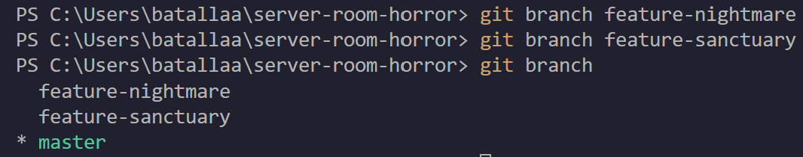
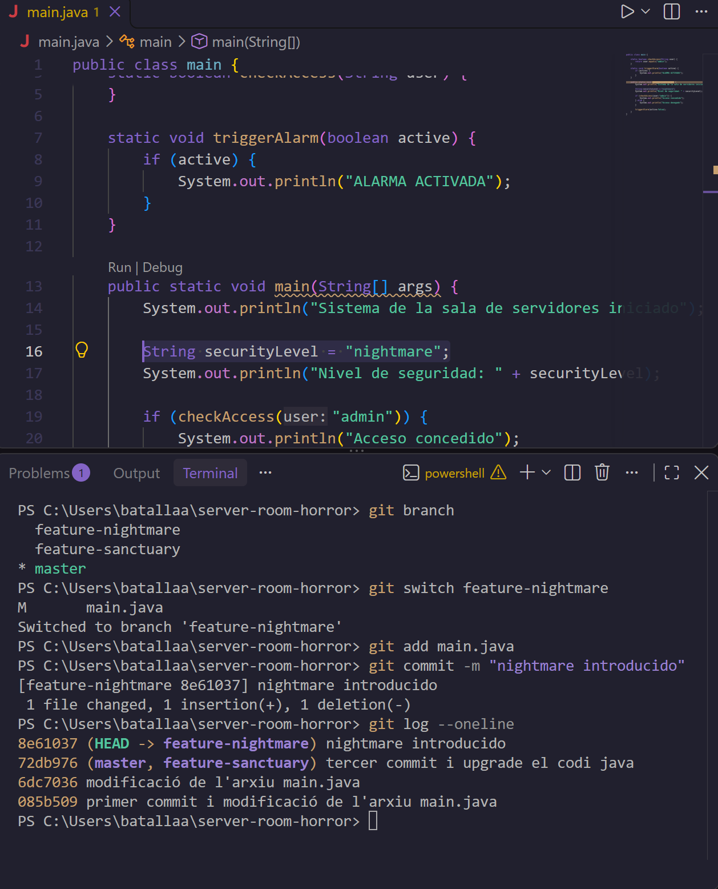
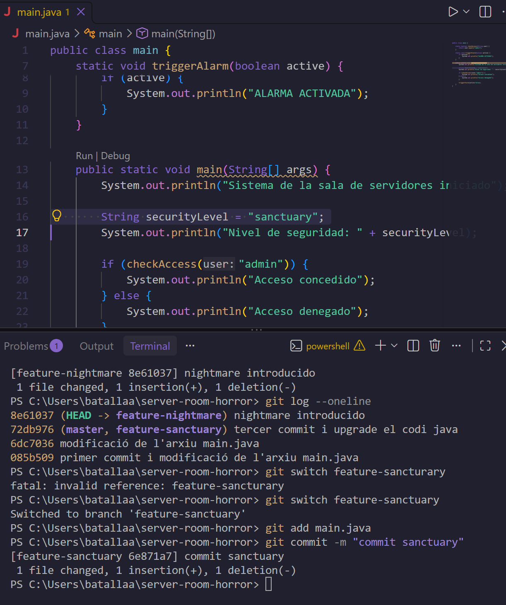
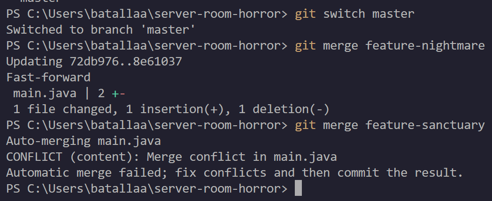
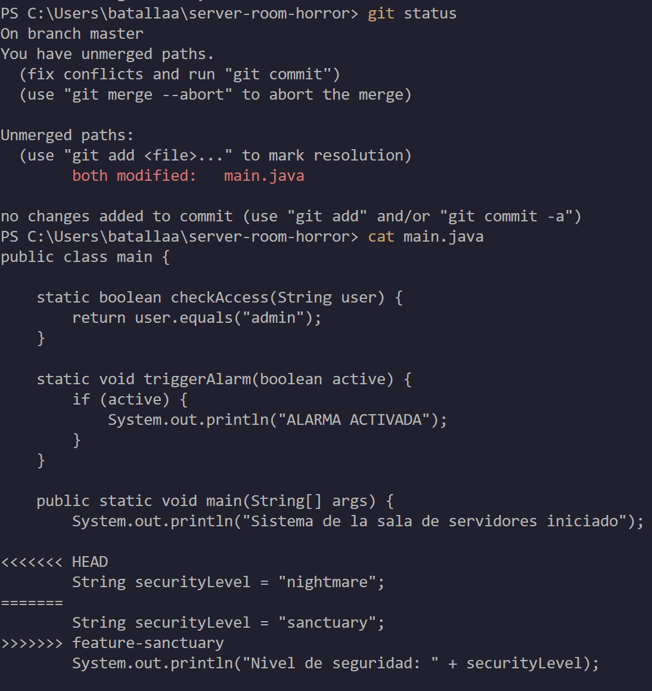
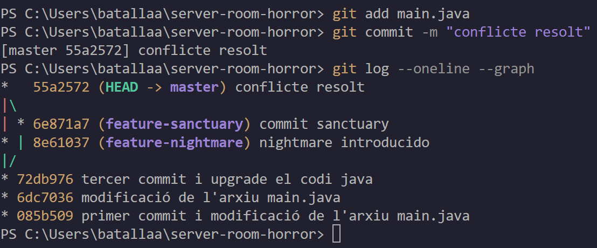

# Bloc 2: Les Branques del Més Enllà i Resolució del Conflicte

[← Bloc 1](bloc1.md) | [README](README.md) | [Bloc 3 →](bloc3.md)

En aquest bloc es creen dues línies temporals paral·leles, es modifica la mateixa línia del codi a cadascuna i es provoca i resol un conflicte de fusió.

---

## Acció 3.6: Creació de les branques

**Explicació tècnica:** amb `git branch <nom>` es creen dues branques noves sense canviar-hi de posició. Les dues apunten al mateix commit: el tercer (`72db976`), que és la punta de `master`. Amb `git branch` sense arguments es llisten i l'asterisc indica la branca activa.

```bash
git branch feature-nightmare
git branch feature-sanctuary
git branch
```



### Justificació de la topologia escollida

Les dues branques surten **del mateix commit** (el tercer de `master`) per aquestes raons:

- Les dues visions són alternatives independents sobre una mateixa base estable; cap no depèn de l'altra.
- Partir del mateix punt permet comparar-les de forma equitativa, ja que han d'arrencar exactament de l'últim estat segur.
- Com que totes dues modifiquen la mateixa línia (`securityLevel`) a partir d'un ancestre comú, es garanteix un conflicte de contingut real en fusionar-les, que és el que demana l'exercici.

---

## Acció 3.7: Branca `feature-nightmare`

**Explicació tècnica:** amb `git switch` es canvia a la branca de la dimensió fosca. Es modifica una sola línia de `main.java` (`String securityLevel = "nightmare";`), es prepara amb `git add` i es desa amb un commit. Finalment, `git log --oneline` mostra que `feature-nightmare` ha avançat un commit mentre `master` i `feature-sanctuary` es queden al tercer.

```bash
git switch feature-nightmare
git add main.java
git commit -m "nightmare introducido"
git log --oneline
```



> **Nota:** el missatge `M main.java` de la captura indica que la modificació ja era feta a l'espai de treball abans del canvi de branca. Git la va portar a `feature-nightmare` sense problemes, ja que no entrava en conflicte amb res.

---

## Acció 3.8: Branca `feature-sanctuary`

**Explicació tècnica:** es canvia a la branca de protecció i es modifica **exactament la mateixa línia** (`String securityLevel = "sanctuary";`). Es registra amb un commit propi. Aquesta branca no conté el commit de `feature-nightmare`, de manera que les dues línies temporals han divergit.

```bash
git switch feature-sanctuary
git add main.java
git commit -m "commit sanctuary"
```



> **Nota:** la captura mostra que el primer `git switch feature-sanctuary` va fallar amb `fatal: invalid reference` i es va repetir correctament a continuació. No ha afectat el resultat.

---

## Acció 3.9: Integració de les dues branques a `master`

**Explicació tècnica:** es torna a `master` i s'integren les branques una darrere l'altra amb `git merge`.

```bash
git switch master
git merge feature-nightmare
git merge feature-sanctuary
```



- **Primera fusió (`feature-nightmare`):** Git fa un *fast-forward*. Com que `master` no havia avançat des que es va crear la branca, no cal cap commit de fusió: Git només mou el punter de `master` fins a `8e61037`.
- **Segona fusió (`feature-sanctuary`):** ara `master` i `feature-sanctuary` han divergit i ambdues han modificat la mateixa línia. Git no pot decidir quina conservar i mostra `CONFLICT (content): Merge conflict in main.java`. La fusió queda aturada a l'espera de resolució manual.

---

## Acció 3.10: Resolució del conflicte

**Explicació tècnica:** `git status` informa que hi ha *unmerged paths* i que `main.java` està *both modified*. Amb `cat main.java` s'observen les marques que Git ha inserit al fitxer:

- `<<<<<<< HEAD`: versió de la branca actual (`master`, que ja conté `nightmare`).
- `=======`: separador entre les dues versions.
- `>>>>>>> feature-sanctuary`: versió de la branca que s'integra.

```bash
git status
cat main.java
```



**Decisió:** per salvar el servidor es conserva la versió de protecció, `String securityLevel = "sanctuary";`, i s'eliminen manualment les tres marques (`<<<<<<<`, `=======`, `>>>>>>>`) i la línia de `nightmare`. El fitxer final queda net de qualsevol marca de Git (es pot veure l'estat final del fitxer a la captura de l'[acció 3.13](bloc3.md#acció-313-reversió-temporal)).

Un cop resolt, es marca el fitxer com a resolt amb `git add` i es finalitza la fusió amb el commit de fusió. Finalment, `git log --oneline --graph` mostra la topologia amb la bifurcació i la reunificació.

```bash
git add main.java
git commit -m "conflicte resolt"
git log --oneline --graph
```



El graf mostra com les dues branques parteixen del commit `72db976` i es tornen a unir al commit de fusió `55a2572` a `master`.

---

[← Bloc 1](bloc1.md) | [README](README.md) | [Bloc 3 →](bloc3.md)
