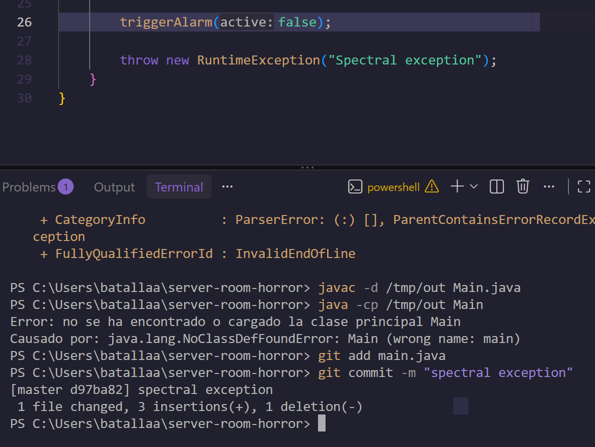
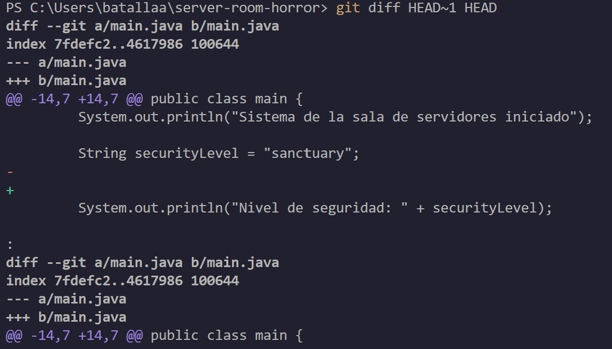
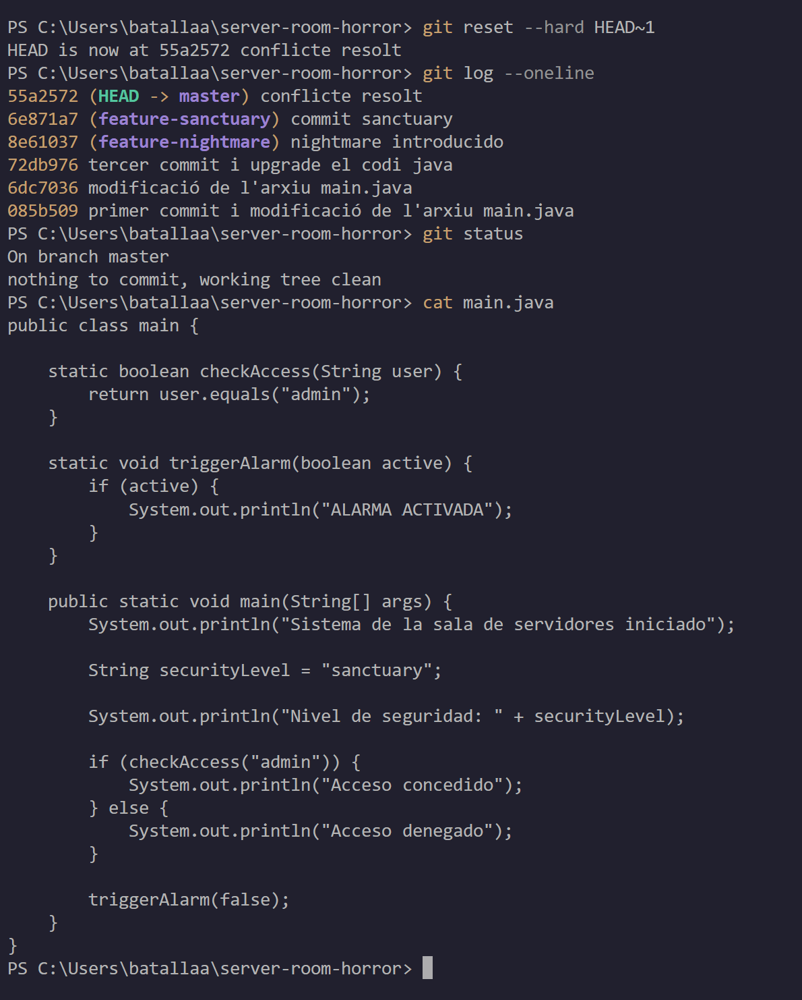
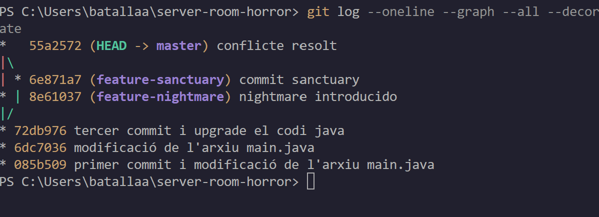

# Bloc 3: Viatge Temporal, Exorcisme del Codi i Publicació Remota

[← Bloc 2](bloc2.md) | [README](README.md)

En aquest bloc l'esperit maligne corromp el codi amb un commit infectat, s'inspecciona la diferència, es reverteix l'historial a l'últim punt segur i es publica el repositori net a GitHub.

---

## Acció 3.11: Commit infectat

**Explicació tècnica:** s'afegeix al final del mètode `main` una línia `throw new RuntimeException("Spectral exception");`, que llança una excepció que ningú no captura i fa caure el programa. Aquest estat defectuós es registra a l'historial amb un commit.

```bash
javac -d /tmp/out Main.java
java -cp /tmp/out Main
git add main.java
git commit -m "spectral exception"
```



> **Nota:** a la captura, l'execució del programa mostra un error de càrrega de classe (`wrong name: main`). Es deu al fet que la classe del projecte s'anomena `main` en minúscula, mentre que s'ha invocat com a `Main`. No afecta l'exercici: el que importa és que el commit infectat `d97ba82` queda registrat.

---

## Acció 3.12: Diferència entre el codi infectat i l'últim punt segur

**Explicació tècnica:** `git diff HEAD~1 HEAD` compara el commit anterior (l'últim punt segur, la fusió `55a2572`) amb el commit actual (l'infectat). Les línies precedides de `-` són les eliminades i les precedides de `+` són les afegides.

```bash
git diff HEAD~1 HEAD
```



---

## Acció 3.13: Reversió temporal

**Explicació tècnica:** `git reset --hard HEAD~1` mou el punter de la branca un commit enrere i, a més, restaura l'àrea de preparació i l'espai de treball a aquell estat. Amb això el codi infectat desapareix del fitxer i el commit deixa de formar part de l'historial visible de `master`.

Després es verifica el resultat amb tres comprovacions:

- `git log --oneline`: l'últim commit ja no és l'infectat, sinó `55a2572 conflicte resolt`.
- `git status`: l'espai de treball està net (*working tree clean*).
- `cat main.java`: el fitxer no conté la línia `throw` ni cap marca de conflicte (`<<<<<<<`, `=======`, `>>>>>>>`).

```bash
git reset --hard HEAD~1
git log --oneline
git status
cat main.java
```



---

## Acció 3.14: Topologia final del repositori

**Explicació tècnica:** `git log --oneline --graph --all --decorate` dibuixa l'arbre complet des de la terminal, incloent-hi totes les branques (`--all`) i les etiquetes de branca i `HEAD` (`--decorate`). Mostra les dues branques que surten del commit `72db976`, el commit de fusió `55a2572` a `master` i la línia temporal ja purificada, sense el commit infectat.

```bash
git log --oneline --graph --all --decorate
```



---

## Acció 3.15: Publicació a GitHub

**Explicació tècnica:** es crea a GitHub un repositori **públic** anomenat `halloween-git-rescue`, sense README ni `.gitignore` inicials per evitar conflictes amb l'historial local. Es vincula amb el repositori local mitjançant un remot anomenat `origin` i s'hi pugen totes les branques. Abans es desa a l'historial la documentació en Markdown i les captures.

### Creació del repositori a GitHub

> 📌 **Pendent:** afegir aquí la captura de la pàgina de creació del repositori `halloween-git-rescue` (públic).

### Commit de la documentació i enllaç amb el remot

```bash
git add .
git commit -m "docs: add Markdown documentation and terminal screenshots"
git remote add origin https://github.com/TU_USUARI/halloween-git-rescue.git
git branch -M main
git push -u origin --all
git remote -v
```

> 📌 **Pendent:** afegir aquí la captura del `git push` i del `git remote -v`.

### Comprovació al web de GitHub

> 📌 **Pendent:** afegir aquí les captures de la pàgina principal del repositori, de la llista de branques (`main`, `feature-nightmare` i `feature-sanctuary`) i de l'historial de commits.

---

[← Bloc 2](bloc2.md) | [README](README.md)
